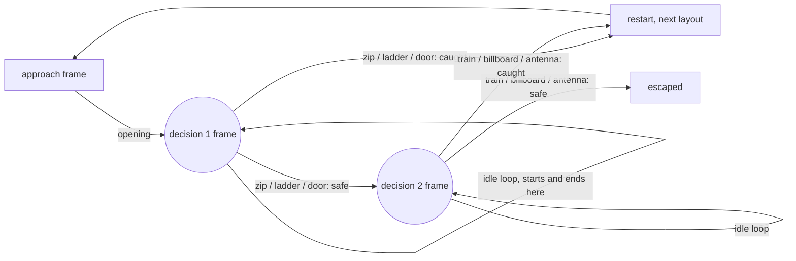

# Split Second

**A rooftop chase you play by tapping the world.** A courier, three ninjas, one way off the roof. Tap what glows. Pick wrong and they catch you, and the chase starts over with a different safe route.

Everything is made in ComfyUI with open-weights models: the keyframes, every clip, and the glowing tap targets.

> Built for the [Open Source Higgsfield](https://comfy.org/open-source-higgsfield) challenge by [NEUKO](https://neuko.ai).

## The idea: pick the moment first

Most AI video stories generate forward and then try to hide the seams between clips. Split Second works backwards. It picks the **decision frames** first, then generates every clip *to* or *from* those frames with first/last-frame video. Every cut lands on identical pixels, so a 15-clip branching story plays like one continuous shot.



Three more pieces make it a game:

- **Tap the world, not a button.** SAM3 finds each object from a sentence ("the red metal door of the small stairwell hut"). The workflow grows the mask, subtracts the original and colors the ring, so each object gets its own glowing outline PNG. The player places those outlines exactly where SAM3 found the objects.
- **Hesitation is a choice.** The idle loop plays four times. Let it run out and they catch you.
- **The safe route rotates.** Every object has both a safe clip and a capture clip. Each run uses a different layout (zipline then train, door then billboard, ladder then antenna), so what saved you last time gets you caught now.

## What's in here

| Path | What it is |
| --- | --- |
| `build_workflows.py` | Generates every workflow below from one place: prompts, seeds, settings |
| `workflows/01_keyframes.json` | The three decision frames, Z-Image Turbo |
| `workflows/02_targets.json` | SAM3 masks and glowing outline crops for the six tap targets |
| `workflows/clips/*.json` | One Wan 2.1 first/last-frame job per clip (15 clips) |
| `workflows/03_all_clips.json` | All 15 clips in one graph, for a GPU with no job time limit |
| `story.json` | The story graph: scenes, decisions, tap targets, rotation |
| `player/index.html` | A dependency-free player for that graph |

## Run it

**1. Models.** Put these in your ComfyUI `models/` folders (all open weights):

| File | Folder |
| --- | --- |
| `z_image_turbo_bf16.safetensors` | `diffusion_models` |
| `qwen_3_4b.safetensors` | `text_encoders` |
| `ae.safetensors` | `vae` |
| `wan2.1_flf2v_720p_14B_fp8_e4m3fn.safetensors` | `diffusion_models` |
| `umt5_xxl_fp8_e4m3fn_scaled.safetensors` | `text_encoders` |
| `wan_2.1_vae.safetensors` | `vae` |
| `clip_vision_h.safetensors` | `clip_vision` |
| `sam3.1_multiplex_fp16.safetensors` | `checkpoints` |

Only core ComfyUI nodes are used. No custom node packs.

**2. Keyframes.** Queue `workflows/01_keyframes.json`. Copy the three images from `output/splitsecond/` into `input/` as `k0_approach.png`, `k1_decision1.png` and `k2_decision2.png`.

**3. Tap targets.** Queue `workflows/02_targets.json` to get the masks. Put each object's crop box in `targets.json`, rerun `python3 build_workflows.py`, and queue it again to get the glowing outlines.

**4. Clips.** Queue each file in `workflows/clips/`. On Comfy Cloud, run them one per job: a single job is capped at about 12 minutes, and each clip takes about 4 on a 14B model.

**5. Play.** Put the clips in `clips/` and the outlines in `targets/`, fill in the `rect` values in `story.json`, then serve the folder and open `player/`:

```sh
python3 -m http.server 8000
# open http://localhost:8000/player/
```

To change the story, edit the prompts in `build_workflows.py` and rerun it.

## Settings

Video: Wan 2.1 FLF2V 14B (fp8), 480×848, 81 frames at 16 fps, 25 steps, cfg 5, uni_pc, shift 5, seed 7.
Keyframes: Z-Image Turbo, 576×1024, 8 steps, cfg 1, res_multistep, shift 3.

## Play the hosted version

A hosted build runs on [bitebox](https://bitebox.gg), NEUKO's interactive video player, wired from the same story graph.

## License

MIT. See [LICENSE](LICENSE).
