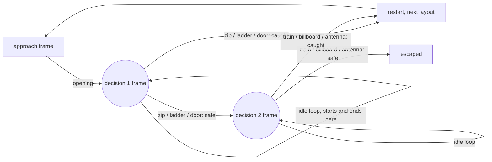

# Split Second

**A rooftop chase you play by tapping the world.** A courier, three ninjas, one way off the roof. Tap what glows. Pick wrong and they catch you, and the chase starts over with a different safe route.

Everything is made in ComfyUI with open-weights models: the keyframes, every clip, and the glowing tap targets.

> Built for the [Open Source Higgsfield](https://comfy.org/open-source-higgsfield) challenge by [NEUKO](https://neuko.ai).

## The idea: pick the moment first

Most AI video stories generate forward and then try to hide the seams between clips. Split Second works backwards. It picks the **decision frames** first, then generates every clip *to* or *from* those frames with first/last-frame video. Every cut lands on identical pixels, so a 15-clip branching story plays like one continuous shot.



Three more pieces make it a game:

- **Tap the world, not a button.** SAM3 finds each object from a sentence ("the red metal door of the small stairwell hut"). The workflow grows the mask, subtracts the original and colors the ring, so each object gets its own glowing outline PNG. The player places those outlines exactly where SAM3 found the objects.
- **Hesitation is a choice.** You get one idle loop to decide. Let it run out and they catch you.
- **The safe route rotates.** Every object has both a safe clip and a capture clip. Each run uses a different layout (zipline then train, door then billboard, ladder then antenna), so what saved you last time gets you caught now.

## What's in here

| Path | What it is |
| --- | --- |
| `build_workflows.py` | Generates every workflow below from one place: prompts, seeds, settings |
| `workflows/01_keyframes.json` | The three decision frames, Z-Image Turbo |
| `workflows/02_targets.json` | SAM3 masks and glowing outline crops for the six tap targets |
| `workflows/clips/*.json` | One job per clip (15 clips), picture and sound in one pass |
| `story.json` | The story graph: scenes, decisions, tap targets, rotation (points at the hosted clips) |
| `bitebox/build_document.py` | Unrolls `story.json` into a bitebox document: three run copies, chained decision loops, SAM3 outlines as Target Overlays |
| `bitebox/split_second.json` | The generated bitebox document |
| `player/index.html` | A dependency-free player for that graph |

## Run it

**1. Models.** Put these in your ComfyUI `models/` folders (all open weights):

| File | Folder |
| --- | --- |
| `z_image_turbo_bf16.safetensors` | `diffusion_models` |
| `qwen_3_4b.safetensors` | `text_encoders` |
| `ae.safetensors` | `vae` |
| `minimax_h3_fl2va_pruned_int8_convrot.safetensors` | `diffusion_models` |
| `minimax_h3_ref2va_pruned_int8_convrot.safetensors` | `diffusion_models` |
| `pika_h3_flex_fl2va_v1_bf16.safetensors` | `loras` |
| `qwen3vl_32b_minimax_h3_nvfp4_awq.safetensors` | `text_encoders` |
| `minimax_h3_video_vae_int8_convrot.safetensors` | `vae` |
| `minimax_h3_audio_vae_fp32.safetensors` | `vae` |
| `sam3.1_multiplex_fp16.safetensors` | `checkpoints` |

Only core ComfyUI nodes are used. No custom node packs.

**2. Keyframes.** Queue `workflows/01_keyframes.json`. Copy the three images from `output/splitsecond/` into `input/` as `k0_approach.png`, `k1_decision1.png` and `k2_decision2.png`.

**3. Tap targets.** Queue `workflows/02_targets.json` to get the masks. Put each object's crop box in `targets.json`, rerun `python3 build_workflows.py`, and queue it again to get the glowing outlines.

**4. Clips.** Queue each file in `workflows/clips/`. Each takes about a minute on Comfy Cloud. Clips that must land on a decision frame (opening, the idle loops, the decision 1 escapes) use Pika H3 Flex with both ends pinned. Captures and the final escapes only need to start on the frame, so they use MiniMax H3 with the first frame as a guide.

**4b. Seam pass.** MiniMax H3 treats the first frame as a guide, not a pin, and renders at 480×864, so cutting into it from a Pika loop pops. Run `python3 seamfix.py`, put each H3 render in `input/` as `h3_<clip>.mp4`, and queue its graph in `workflows/seamfix/`. It scales the clip to 576×1024 and dissolves from the anchor keyframe over the first quarter second, so every cut starts on the frame the loop ends on.

**5. Play.** `story.json` already points at the hosted clips and outlines, so the local player works as is. To use your own renders, point the `scenes` and `glow` entries at your files. Then serve the folder and open `player/`:

```sh
python3 -m http.server 8000
# open http://localhost:8000/player/
```

To change the story, edit the prompts in `build_workflows.py` and rerun it.

## Settings

Pinned clips: Pika H3 Flex LoRA on MiniMax H3 first/last-frame, 576×1024, 124 frames at 24 fps with audio, 6 steps lcm (manual sigmas), seed 7.
Open-ended clips: MiniMax H3 reference-to-video with a frame 0 guide, 480×864, 124 frames at 24 fps with audio, 20 steps res_multistep, seed 7; then the seam pass (lanczos to 576×1024, 6-frame dissolve from the anchor).
Keyframes: Z-Image Turbo, 576×1024, 8 steps, cfg 1, res_multistep, shift 3.

## Play it on bitebox

The hosted build runs on [bitebox](https://bitebox.gg), NEUKO's interactive video player. ComfyUI makes every pixel; bitebox does the part ComfyUI can't: branching, timing, taps and the run-to-run rotation.

bitebox has no random rule, so `bitebox/build_document.py` unrolls the rotation into copies of the run. Every capture plays into the next copy's opening. Each decision gives you one five-second loop with the glowing SAM3 outlines on top as tap targets; let it run out and the hesitation capture plays. bitebox's publish check walks at most 200 paths, so the hosted build alternates two layouts (43 paths); the local player rotates all three.

```sh
python3 bitebox/build_document.py bitebox/media.json > bitebox/split_second.json
```

## License

MIT. See [LICENSE](LICENSE).
